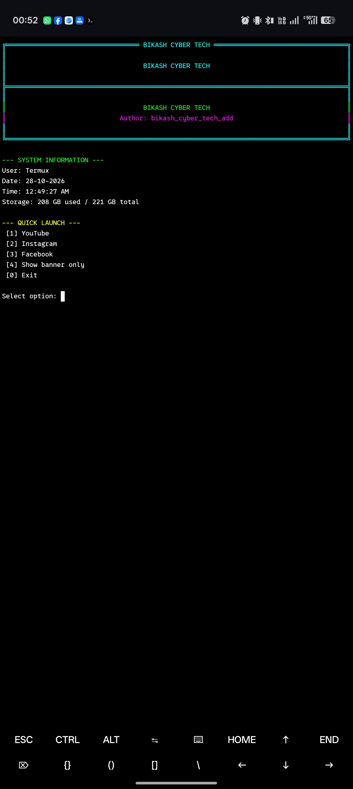

# ⚡ TermiDeck Cyber Terminal


**BIKASH CYBER TECH** — A Neon-Style Terminal for Termux
  


## 📸 TermiDeck Preview



---


**A Colorful Neon Hacker-Style Terminal for Termux**

TermiDeck is a lightweight terminal customization tool featuring a cyber-style banner, system information, storage monitoring, and quick-launch shortcuts.

**Author:** bikash_cyber_tech_add

## ✨ Features

- 🟢 Neon green, cyan, and magenta terminal theme
- 💻 Hacker-style terminal banner
- 📊 System information display
- 💾 Storage usage monitoring
- 🕒 Current date and time
- 🌐 Quick launch for YouTube, Instagram, and Facebook
- ⚙️ Simple installation and uninstallation
- 📱 Designed for Android and Termux

## 📋 Requirements

- Android device
- Termux
- Python 3.8+
- Git
- Termux:API (for URL shortcuts)


## 🚀 Installation

### 1. Update Termux and install packages

```bash
pkg update -y
pkg install python git -y
```

### 2. Clone the repository

```bash
git clone https://github.com/pujamurmu49492-jpg/BH-Bikash-Ethical-GitHub_.git
cd BH-Bikash-Ethical-GitHub_
```

### 3. Install dependencies

```bash
pip install -r requirements.txt
```

### 4. Run TermiDeck

```bash
python termideck.py
```

**Note:** Cloning the repository does not automatically install the `BIKASH-CYBER-TECH` launcher.
